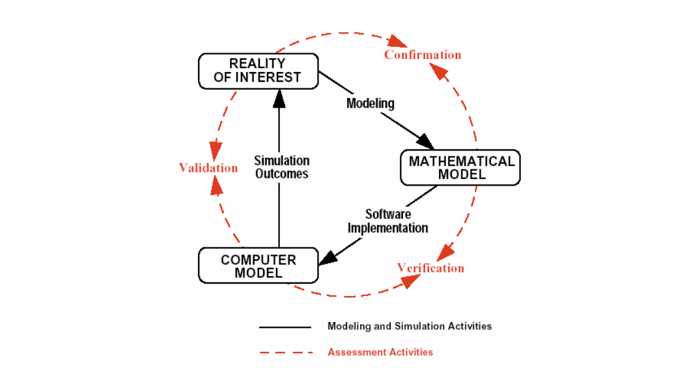
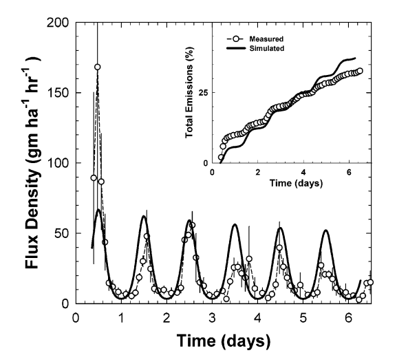
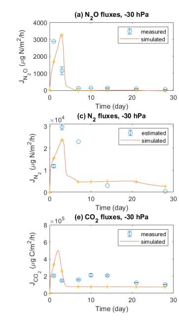
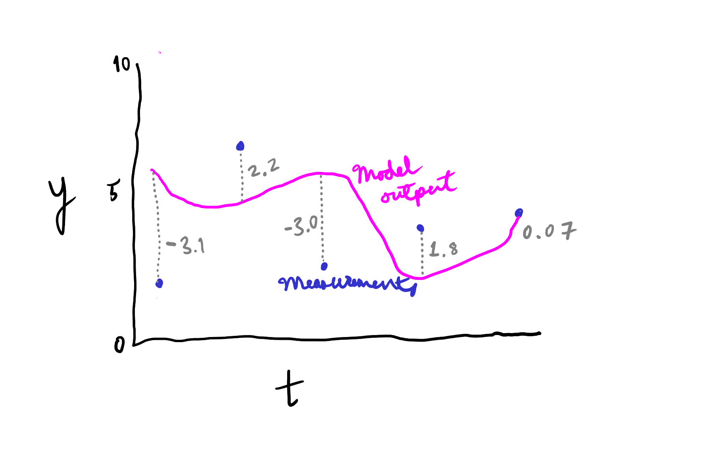
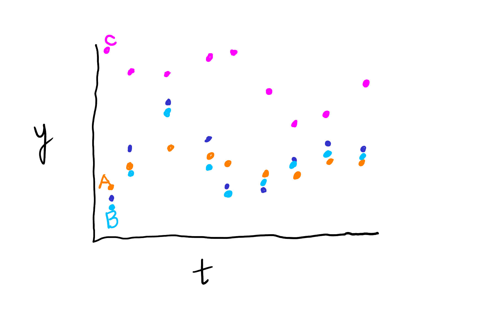

# Verification and validation {#sec-vv}

The statistician George Box is famous for a quote that goes something like "all models are wrong, but some are useful".
Maybe he didn't use that exact wording but the sentiment is definitely correct (see @box_science_1976 and @Box_George_E_P_1987 for more).
Indeed, both parts are true.
Although model error cannot be completely eliminated, the portion that can be eliminated should be, and the rest should be quantified and understood.
Verification and validation address the problem of model error, and are essential steps in the "modelling process".
They should be carried out before any confidence is placed in model predictions.

Verification is essentially ensuring that the mathematical model--developed through a model formulation process (@sec-formulation)--has been programmed or implemented correctly.
For us, that means checking that our Python code is correct.
That alone does not ensure the model produces accurate predictions; of course any mathematical model of a real process or system has error too.
It is common to find implementation errors through model verification.
Finding these errors after a model has been applied, and after its predictions have affected policy is quite uncomfortable!
They should be found and corrected before.
A clear and explicit model formulation and careful programming can reduce implementation errors, but verification is always needed.

In contrast, validation is done by comparing model output to measurements from the system under study.
Because validation is done after verification, code errors should already be eliminated, so any error seen in in validation can be interepreted as (most likely) coming from either model structure or parameter values.
It may be that a problem was missed during verification, however, so when a problem is found in the validation stage, the model developer should always think about the likely cause of the problem, and how to improve the model.
Verification and validation are often together called "V&V".

@fig-vv1 shows where verification and validation fit in the model development process.
The connections between the software model (your Python code) and, first, the mathematical model (what you developed through model formulation), and some measurement data, called the "reality of interest" in the figure.

{#fig-vv1 fig-alt="V&V concept."}

One important point that model developers and users should both understand is that successful V&V does not prove that a model is correct. 
In fact, only model failure shows anything with any certainty: that a model is wrong.
But V&V can provide evidence that the model is accurate enough for application.
Both verification and validation are described in more detail in the sections below.

## Verification

Verification is about making sure your model has been implemented correctly.
So how exactly do you do that?
You should carefully check model code for:

* accurate governing equations and 
* consistent units.

If relevant, also check code for:

* accurate constitutive equations, 
* accurate linking equations, and
* accurate mass or energy conservation.

When checking code, you should look for equations completeness and correctness by comparison to your model equations, written with pencil and paper or typed out somewhere.
Of course, this presumes that the original model formulation and description are accurate.
Unit consistency can be checked by entering units above terms in equations right in the model code.
In the code chunk below, `Q-solar` is supposed to be the heat flux of solar energy, in units of W.
Unit comments work like this, where line 2 has the original model code and line 1 a comment with units:

```{python}
#| eval: false
#                  m^2 *  W/m^2 -> W
        Q_solar = a_top * q_sol             # Solar energy (W)
```

Additionally, careful model calls themselves can be used for verification.
Check ultimate or limiting cases, where you have a clear expectation of what the model should show.
If a simpler analytical model is available, its predictions can be compared to those from the more complex model under appropriate conditions.
With this approach you can find problems without information on the causes.
Then experience, model call "experiments", and a check of the code can help identify the causes.
Some will require digging into the model code itself from the start, stepping through the code as it is evaluated using `breakpoint()`, or exporting intermediate results for checking. 

Model verification requires a good understanding of the underlying conceptual and mathematical models! 
Otherwise, how would you know what to expect?

Conservation can be checked by tracking cumulative transport.
Cumulative transport can be added as a state variable by simply integrating the ODE for mass or energy flow at the domain boundaries
The integrated cumulative totals can be compared it to the change in total energy or mass in the model domain for a conservation check.

### Pool model code verification

Let's use a swimming pool model as a demo for verification.
Conceptually, this model is similar to the cooling coffee cup model from @sec-solving and elsewhere.
A pool exchanges heat energy with its environment through multiple pathways: with the air from the water surface, with the substrate through the sides and bottom of the pool, through an external heater, and, in one direction, from the sun.

First, the model code from the `pool_mods` module:

```{.python filename="pool_mods.py"}

```

And now some verification.
If we have a clear GE from model formulation, we can check that.
But for numerical models, it is common to calculate individual GE terms separately and then add them up using the appropriate variable symbols.
So here let's start with a check of

1. conservation, and
2. constitutive equations.

During model formulation for this model we came up with this energy conservation equation:

```{python}
#| eval: false
Rate of energy accumulation = solar + air/top + soil/substrate + renewal
```

The `renewal` term is where the external heat comes in.
All are in W.
In verification, we should compare that original conservation equation to our model code.
Here, the code has this:

```{python}
#| eval: false
        Q_net = Q_solar + Q_top + Q_renew
```

Is it OK?
No!
We are missing energy transfer from soil/substrate.
Checking the module code above shows it is actually calculated, just not used.
So we can add it:

```{python}
#| eval: false
        Q_net = Q_solar + Q_top + Q_sub + Q_renew
```

Now for a check of the constitutive equations.

The code:
```{python}
#| eval: false
        # Calculate heat flow (W) through individual pathways
        # All are positive for heat flow in (this is arbitrary)
        Q_solar = a_top * q_sol                                     # Solar energy
        Q_top = a_top * u_top * (temp_air - temp_pool)              # Convection from top
        Q_sub = a_wall * u_wall * (temp_sub - temp_pool)            # Conduction to/from substrate (soil or whatever is there)
        Q_renew = cp * dens * flow_renew * (temp_pool - temp_renew) # Net energy coming in from renewal water
```

The checking part follows, where we have copied a single line a few times to think about it in some different ways.
This just applies to one of the terms in the GE.
Typically, not all of these comments would be left in the model code.
The checks included below include two conceptual/qualitative checks on the calculation of heat flow and one to check the direction/sign.

```{python}
#| eval: false
    	#   CHTS = combined heat transfer coefficient
        #        Area *  CHTC * delta T -> OK
        Q_top = a_top * u_top * (temp_air - temp_pool)              # Convection from top
        #       Area  * ------flux------------------- -> OK
        Q_top = a_top * u_top * (temp_air - temp_pool)              # Convection from top
        #                         High    -  low ->    postitive -> heat transfer into pool -> OK
        Q_top = a_top * u_top * (temp_air - temp_pool)              # Convection from top
```


During actual V&V, we would need to check *all* equations. 

Now some check of units.
But here let's focus on that same line of code from above as an example.
Here we find that the units look OK.


```{python}
#| eval: false

#        Overall heat transfer coefficient from the upper water surface (W/m2-K)
#               m^2   * W/m2-K  * ----------K---------- -> W  (OK)
        Q_top = a_top * u_top   * (temp_air - temp_pool)              # Convection from top (W)
```

To be sure that even this single line of code is correct, we have to check that the inputs `a_top` etc. have the correct units. 
These should be defined in the docstring.
We see:

```{python}
#| eval: false

    a_top : float
       Area of pool water surface at the top (m2) 
    . . . 
    u_top : float
        Overall heat transfer coefficient from the upper water surface (W/m2-K)
    . . . 
    temp_air : float
        Constant air temperature (degree C)
```

Those three look fine, once we remember that a temperature difference is the same in $\degC$ and K.
Now, of course this doc string has no effect on the actual calculations carried out by the model, but it tells the user the units for the inputs.
And if everything is correct up/back to here, the rest is up to the user.

Now the linking equation, starting with a conceptual check.

```{python}
#| eval: false
  # temp change = energy in / (energy required for 1 K change in 1 kg * mass/vol * vol) -> seems OK
        dtemp_dt = Q_net / (cp * dens * vol)
```

And unit check.
```{python}
#| eval: false
        #          J/s   / J/K-kg * kg/m3 * m3 -> K/s  (OK)
        dtemp_dt = Q_net / (cp    * dens * vol)
```

Compare to the information in the model function docstring:

```{python}
#| eval: false
    cp : float 
        Specific heat capacity of water (J/kg-K) 
    dens : float
        Density of water (kg/m3)
```

All OK?
Seems so, yes.

### Verification with model calls

Next, let's look at some model calls.

```{python}
# Packages
import numpy as np
import matplotlib.pyplot as plt
from importlib import reload

# Get out pool model functions (loading a module here)
# This will not load a new version!
import pool_mods as pm

# Use as needed (reload(pm) if module code is changed)
reload(pm)

# Set dimensions (all distances m, all areas m^2).
# Assume pool is 10 x 4 x 2 m.
length = 10
width = 4
depth = 2
a_top = length * width
a_wall = 2 * (length + width) * depth + a_top

# And a demo model call
pred01 = pm.dynmod(
    a_top=a_top,
    a_wall=a_wall,
    depth=depth,
    q_sol=0,
    u_top=100,
    u_wall=3,
    temp_air=10,
    temp_sub=10,
    flow_renew=0,
    temp_renew=0,
    temp_init=30,
    times=np.arange(0, 12 * 3600 + 3600, 3600)
)

# Check results
pred01
pred01['temp']

# And 
plt.plot(pred01['t'] / 3600, pred01['temp'])
plt.xlabel('Time (h)')
plt.ylabel('Pool temperature (deg. C)')
```

Let's think about steady-state.
Should there be a steady state condition?
Sure! 
Do we see one above?
No.
Why not?

How about if we run the model for 10 days?

```{python}
# And a demo model call
pred01 = pm.dynmod(
    a_top=a_top,
    a_wall=a_wall,
    depth=depth,
    q_sol=0,
    u_top=100,
    u_wall=3,
    temp_air=10,
    temp_sub=10,
    flow_renew=0,
    temp_renew=0,
    temp_init=30,
    times=np.arange(0, 10 * 24 * 3600 + 3600, 3600)
)

plt.plot(pred01['t'] / 86400, pred01['temp'])
plt.xlabel('Time (d)')
plt.ylabel('Pool temperature (deg. C)')
```

Ah, just a matter of time, right?
And does that steady-state (or equilibrium?) temperature match expectations?

We have no solar radiation in these scenarios.
With the sun shining, the pool water should warm above ambient temperature.
But as the water warms above air temperature, it will lose heat at a higher and higher rate, until the fixed rate of heat gain from the sun matches the variable rate of heat loss to air.
Do we see that behavior?

```{python}
# Let's add 200 W/m2 of sun, keep environment at 10, and see
pred02 = pm.dynmod(
    a_top=a_top,
    a_wall=a_wall,
    depth=depth,
    q_sol=200,
    u_top=100,
    u_wall=3,
    temp_air=10,
    temp_sub=10,
    flow_renew=0,
    temp_renew=0,
    temp_init=10,
    times=np.arange(0, 12 * 3600 + 3600, 3600)
)

pred02

# Run it for a long time
pred03 = pm.dynmod(
    a_top=a_top,
    a_wall=a_wall,
    depth=depth,
    q_sol=200,
    u_top=100,
    u_wall=3,
    temp_air=10,
    temp_sub=10,
    flow_renew=0,
    temp_renew=0,
    temp_init=10,
    times=np.arange(0, 30 * 86400 + 86400, 86400)
)

pred03['temp']

plt.plot(pred03['t'] / 86400, pred03['temp'])
plt.xlabel('Time (d)')
plt.ylabel('Pool temperature (deg. C)')
```

As expected?
Higher or lower than ambient?
What about the oscillations?

When we have access to an analytical, or generally a simpler, version of a model, it is smart to use it for verification. 
Although the simpler model may also have errors, perhaps even some of the same errors as the model we are trying to verify, simpler means easier to verify.
Therefore verification errors are less likely in simpler models.

Here, we do have a simpler, steady-state model, implemented in the `ssmod()` function.
Does the steady-state result from the numerical model (i.e., after a long time) match the steady-state model?

```{python}
pm.ssmod(
    a_top=a_top,
    a_wall=a_wall,
    depth=depth,
    q_sol=200,
    u_top=100,
    u_wall=3,
    temp_air=10,
    temp_sub=10,
    flow_renew=0,
    temp_renew=0
)
```

```{python}
pred03['temp'][10:]
```

Hmmm, does it?
Is there an error in the model?

Try renewal.
If we are interested in steady state, we might just return a few times

```{python}
pm.dynmod(
    a_top=a_top,
    a_wall=a_wall,
    depth=depth,
    q_sol=0,
    u_top=100,
    u_wall=3,
    temp_air=10,
    temp_sub=10,
    flow_renew=0.1,
    temp_renew=30,
    temp_init=10,
    times=[0, 3600, 86400, 10*86400] 
)
```

Big problem!
We get massively negative temperature
Let's dig into this, first with some more model calls
Let's think about how model calls could be used to identify the problem.
We can start by trying smaller delta T and shorter time to slow down heat transfer and time, in a sense.

```{python}
pm.dynmod(
    a_top=a_top,
    a_wall=a_wall,
    depth=depth,
    q_sol=0,
    u_top=100,
    u_wall=3,
    temp_air=10,
    temp_sub=10,
    flow_renew=0.1,
    temp_renew=10.1,
    temp_init=10,
    times=np.arange(0, 101)
)

```

Adjust the time a bit if needed (this was already done above).
What does that tell us?

Try `breakpoint()` to see what is happening.
Let's edit the module like this, adding `breakpoint()` to a line where we can check the numeric value of `Q_renew`, and save it.
     
```{python}
#| eval: false
...
    # Define rates function
    def rates(t, temp_pool):

        # Net energy, expressed as positive for increase 
        # One nice things about numerical solutions is you are not required to simplify the governing equation.
        # In fact it can be helpful to understand the different pathways to keep them separate

        # Calculate heat flow (W) through individual pathways
        # All are positive for heat flow in (this is arbitrary)
        Q_solar = a_top * q_sol                                     # Solar energy
        Q_top = a_top * u_top * (temp_air - temp_pool)              # Convection from top
        Q_sub = a_wall * u_wall * (temp_sub - temp_pool)            # Conduction to/from substrate (soil or whatever is there)
        Q_renew = cp * dens * flow_renew * (temp_pool - temp_renew) # Net energy coming in from renewal water

        breakpoint()

        # And sum them
        Q_net = Q_solar + Q_top + Q_renew

        # Express as temperature change
        dtemp_dt = Q_net / (cp * dens * vol)

        return dtemp_dt
...
```

Then we need to reload the module and call the function, like this.

```{python}
#| eval: false
reload(pm)

pm.dynmod(
    a_top=a_top,
    a_wall=a_wall,
    depth=depth,
    q_sol=0,
    u_top=100,
    u_wall=3,
    temp_air=10,
    temp_sub=10,
    flow_renew=0.1,
    temp_renew=10.1,
    temp_init=10,
    times=np.arange(0, 101)
)

# Check:
Q_renew
# Negative or positive?
temp_pool
temp_renew
```

In the interactive debugging session, we can check the value of any existing object by typing its name.
So let's see what `Q_renew` looks like.

```{python}
#| eval: false
> pool_mods.py(94) rates()
-> Q_net = Q_solar + Q_top + Q_renew
(Pdb) Q_renew
array([-41800.])
(Pdb) temp_pool
array([10.])
(Pdb) temp_renew
10.1
```

So with a value of `temp_renew` higher than `temp_pool`, we get a negative value for `Q_renew`, while the comment at the top of that block (and the other code) shows that `all are positive for heat flow in (this is arbitrary)`.
So that is a mistake!

See module code in `rates()` in the relevant part of the `pool_mods.py` module.

```{python}
#| eval: false
Q_renew = cp * dens * flow_renew * (temp_pool - temp_renew) # Net energy coming in from renewal water
```

It should look like this.

```{python}
#| eval: false
Q_renew = cp * dens * flow_renew * (temp_renew - temp_pool) # Net energy coming in from renewal water
```

There are many ways that model calls can be used for model verification, but they depend on the specifics of the model.
Other possible checks here could include:

* Correct steady-state predictions with solar radiation and other changes to inputs (possibly changed independently or stepwise)
* Correct qualitative effects of changes to inputs (more or less radiation, higher or lower substrate temperature or resistance)

For a quantitative check of energy balance, we can add cumulative heat transfer as a state variable.
This is done in the `dynmod_pp()` function defined in the same module. 
The function is copied below as well.

```{python}
#| eval: false

# Define a model with cumulative transport state variables
# pp is for ++, as in more than the original model :)
def dynmod_pp(a_top,    
              a_wall,       
              depth,
              q_sol,
              u_top,
              u_wall,
              temp_air,
              temp_sub,
              flow_renew,
              temp_renew,
              temp_init,
              times, 
              cp=4180,
              dens=1000
):  

    """ 
    Dynamic model for heat loss from an outdoor swimming pool. 

    Parameters
    ----------
    a_top : float
       Area of pool water surface at the top (m2) 
    ... 
    """
     
    # Define rates function
    def rates(t, ys):

        # Extract pool temperature from the array of ys
        temp_pool = ys[0]

        # Net energy, expressed as positive for increase 
        # One nice things about numerical solutions is you are not required to simplify the governing equation.
        # In fact it can be helpful to understand the different pathways to keep them separate

        # Calculate heat flow (W) through individual pathways
        # All are positive for heat flow in (this is arbitrary)
        Q_solar = a_top * q_sol                                     # Solar energy
        Q_top = a_top * u_top * (temp_air - temp_pool)              # Convection from top
        Q_sub = a_wall * u_wall * (temp_sub - temp_pool)            # Conduction to/from substrate (soil or whatever is there)
        Q_renew = cp * dens * flow_renew * (temp_pool - temp_renew) # Net energy coming in from renewal water

        # And sum them
        Q_net = Q_solar + Q_top + Q_renew

        # Express as temperature change
        dtemp_dt = Q_net / (cp * dens * vol)

        # Also package the heat transfer rates (W)
        Qs = np.array([Q_solar, Q_top, Q_sub, Q_renew])

        return np.append(dtemp_dt, Qs)

    # Total water volume (m3)
    vol = a_top * depth

    # Now solve with solve_ivp()
    # See 0s for cumulative heat transfer
    res = solve_ivp(rates, t_span = [min(times), max(times)], 
                    y0 = [temp_init, 0, 0, 0, 0], t_eval = times
    )

    # Create a dictionary to hold results
    out = {
        "t": res.t, 
        "temp": res.y[0, :], 
        "h_solar": res.y[1, :], 
        "h_top": res.y[2, :], 
        "h_sub": res.y[3, :], 
        "h_renew": res.y[4, :]
    }

    return(out)

```
 
Let's try this new version

```{python}
reload(pm)

pm.dynmod_pp(
    a_top=a_top,
    a_wall=a_wall,
    depth=depth,
    q_sol=0,
    u_top=100,
    u_wall=3,
    temp_air=10,
    temp_sub=10,
    flow_renew=0.1,
    temp_renew=10.1,
    temp_init=10,
    times=np.arange(0, 10)
)
```

See huge negative h_renew (J).
Wrong sign!
And a flow of 0.1 $\mcbps$ is probably high for a pool that is 10 x 4 x 2 = 80 $\mcb$.
And do you see how these cumulative transport state variables can be useful?

## Validation
Validation is about assessing the accuracy of the model by comparison to the real world.
A "validated" model cannot be assumed to be accurate under all possible conditions, but it can show that the model is accurate enough for its intended use.
Take a look at @fig-vv1 for a reminder of where validation fits into the modelling process.

Requirements:

* Measurements and model outputs must be for the same thing (including time)
* Application or conditions should be of interest (validation is specific)

Selection of a variable for validation depends on what is available and what is useful.
In some cases we won't have measurements of the arguably most important state variables in a model.
For example, the active microbial biomass may be an important state variable in a microbial model, but it can be very difficult or impossible to measure. 
Instead, the concentration of a substrate or product may be the only variable available.
Therefore, validation must be based on these.
It is entirely possible, and probably often the case, that a model could show suitable validation for one variable but actually be totally wrong for another.

Even when a variable has been identified, there are usually multiple ways that validation could be done.
We will consider a few graphical (visual) approaches and some quantitative options here.

## Graphical validation

Plots can be useful for comparing the overall goodness of fit between a model output and mesurements, as well as details about particular issues.
Here are the approaches we will explore:

* both over time or some other input variable or parameter to show both overall comparison and response to the input,
* residuals to show trends in bias, and
* scatterplot showing correlation.

For a dynamic model, it usually makes sense to do validation over time. 
@fig-pestmod1 below shows an example for a model of pesticide volatilization from a soil surface.
The main plot there shows volatilization rate as a flux.
We can see a few things:

1. The general level of model predictions is similar to measurements. 
   There is no major overall bias.
2. Both model and measurements show a clear diurnal pattern. 
   (Presumably this is driven by diurnal temperature variation, and if we had developed or applied this model, this is a detail we should be aware of!) 
3. The model underestimates the magnitude of the decline in volatilization rate over time, as well as the decline in the amplitude of the diurnal pattern.

{#fig-pestmod1 fig-alt="Volatilization of a pesticide."}

Do you see any other interesting results?

The smaller inset plot in @fig-pestmod1 shows another variable, cumulative emission or volatilization.
This variable is calculated directly from measured volatilization rate by some kind of numerical integration.
For example, calculating the area under the dashed line in the main plot would be a kind of trapezoidal integration.
While both variables may be interesting from a validation perspective, it is important to understand that they are not independent.

The validation shown in @fig-denitmod1 includes multiple independent response variables.
Model output is from a soil microbiology model.
The multiple response variables are the flux of $\ce{N2O}$, $\ce{N2}$, and $\ce{CO2}$.
The use of multiple variables can provide more information about problems with a model.
For example, @fig-denitmod1 shows that while the model predicts nearly the same pattern for all three gases, measurements show a relatively flat response in $\ce{CO2}$.
This suggests that the model processes responsible for $\ce{CO2}$ production may be structurally wrong.

{#fig-denitmod1 fig-alt="Denitrification model validation."}

Do you notice how the model output in @fig-pestmod1 is shown using smooth lines?
This suggests that the model was evaluated with a high temporal resolution, i.e., at times that were close together.
While the measurements (points) seem to have a timestep of 2-3 hours, the model output must have a much closer spacing, because it is clear that the lines show curvature between measurement times.
This is common; use of a small timestep to produce model output provides a smooth curve that shows, graphically, precisely what the model predicts, even between measurement times.

Comparing measurements and model output over time has limitations.
Especially for simple models, we may only see if the model predicts a higher or lower rate of change.
Plotting state variable values vs. other model inputs can provide insight into why a model fails.

## Model fit statistics

Model fit statistics summarize how well the measurements and model output match.
Here, a statistic is just some defined measurement that summarizes data.
Several statistics exist, but we'll focus on three that are useful and common.
All are based on the numeric difference between the model output and available measurements, also called *residuals* or *model error*.
@fig-fit-stats0 show residuals as dashed gray lines.
Note that residuals can be positive (when the model overpredicts, meaning the model output is larger than the measurement) or negative (model underpredicts).
But note that the sign of residuals varies among different fields.

{#fig-fit-stats0 fig-alt="Model residuals or error"}

Mean bias error (MBE) is the average difference between model output and measurements, or the average error:

$$
MBE = \frac{ \sum_{i=1}^{N} y_{p,i} - y_{m,i}} {N},
$${#eq-mbe}

where $MBE=$ mean bias error, $y_{p,i}=$ the $i^{th}$ predicted value of the dependent variable $y$, $y_{m,i}=$ the $i^{th}$ measured value of the dependent variable, and $N=$ the number of observations.
The expression $y_{p,i} - y_{m,i}$ is the model residual or error for time or observation $i$.

Positive MBE means the model tends to predict higher values than the measurements show (positive bias), and negative means lower (negative bias).
In @fig-fit-stats1, output C has a large positive MBE, because it is consistently larger than the measurements.
Output B in the same figure has a negative MBE, because its values are lower than measurements for all but one point.
But the absolute value (distance from zero) of MBE is much smaller for B than C.

{#fig-fit-stats1 fig-alt="Fit statistics demo"}

Mean absolute error (MAE) is the mean of absolute error.
It is always positive, and a smaller value means lower error.

$$
MAE = \frac{ \sum_{i=1}^{N} | y_{p,i} - y_{m,i}|} {N},
$${#eq-mae}

Lastly, root mean square error (RMSE) (also called root mean squared deviation, RMSD) is based on the squared errors: 

$$
RMSE = \sqrt{ \frac{ \sum_{i=1}^{N} ( y_{p,i} - y_{m,i} )^2} {N}}.
$${#eq-rmse}

Like MAE, it is always positive, and higher values mean a worse fit.
In @fig-fit-stats1, output B has the smallest MAE and RMSE, followed by A, and finally C.
Also, the difference between MAE for B and A is less than the difference between RMSE for these two.
This is because RMSE gives more weight to larger errors through the squared term.
Of the two, RMSE is more commonly used than MAE.

To quantitatively validate a model, i.e., to apply MBE, RMSE, or other fit statistics, it is essential to have measurements and model output at the exact same time.
This differs from graphical validation, where additional insights into model predictions can come from using a small timestep to generate model predictions.
In fact, a better representation of the data used for quantitative model validation in @fig-fit-stats1 would look like @fig-fit-stats2.
It can be harder to understand a plot where measurements and model output are both shown as points though.
In practice, it is common to produce two distinct sets of model output when performing validation: one for graphical and one for quantitative validation.

{#fig-fit-stats2 fig-alt="Fit statistics demo with points"}

## References {.unnumbered}
