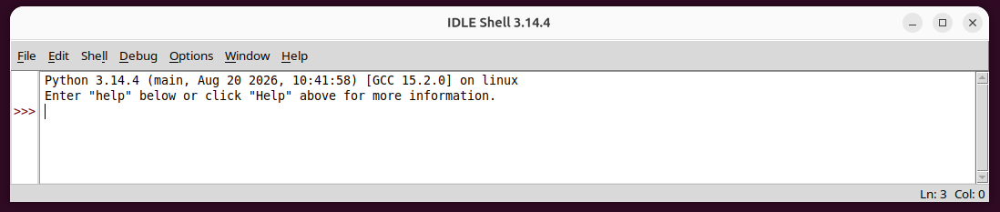
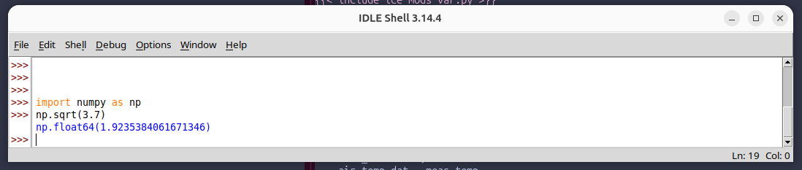
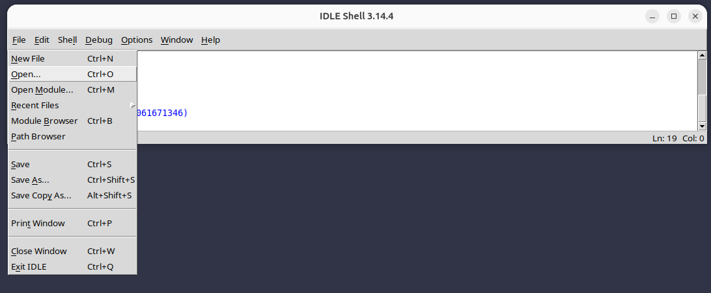
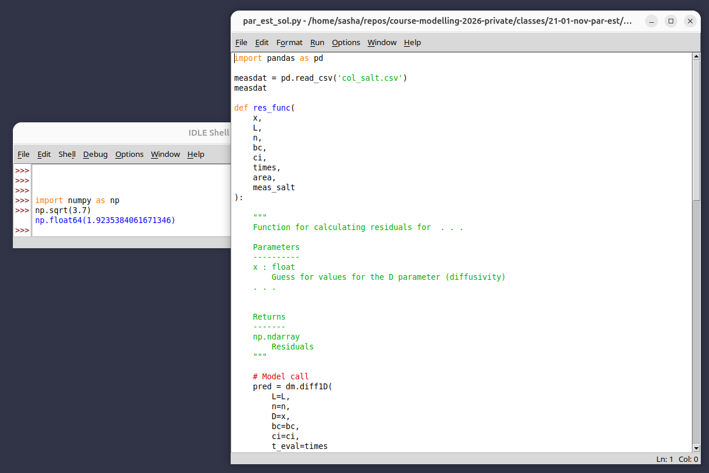
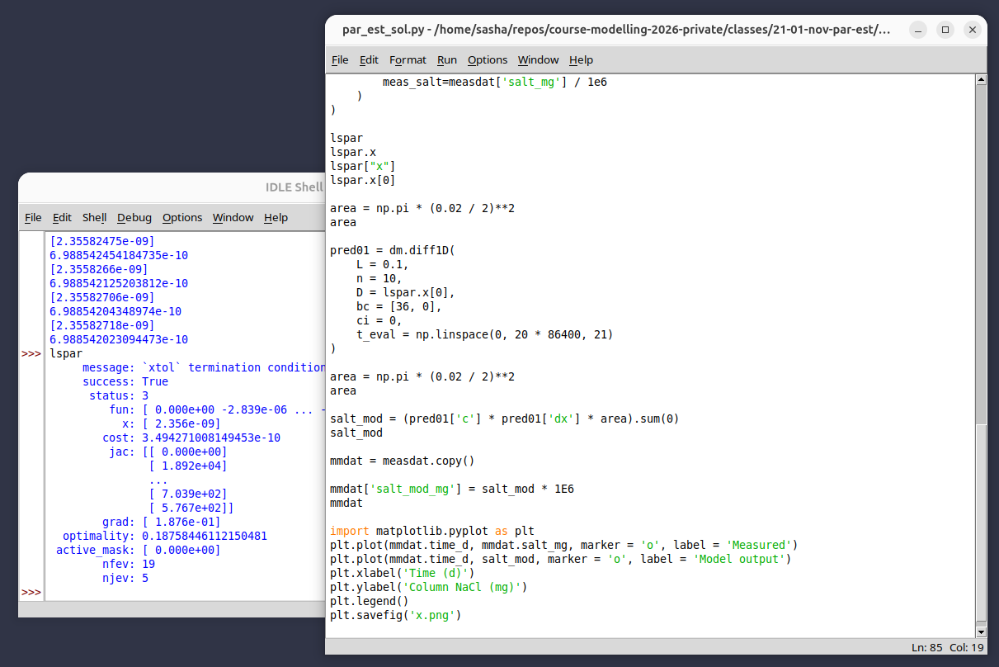

# Introduction to IDLE {#sec-appx-idle}

## Overview

This guide provides basic information on using Python in IDLE, a simple but sufficient integrated development environment (IDE).
IDLE is simple, and that is its strength.
If you have struggled with VS Code, you might check it out.

## Installing IDLE
IDLE is automatically installed with Python.
So after installing Python 3 from  here, you will also have IDLE: <https://www.python.org/downloads/>.
Easy!

## Using IDLE
Open IDLE the normal way, e.g.,

* on Windows, hit the Windows key and type IDLE
* on Mac OS, go to Finer, then applications, and IDLE,
* on Linux, run `python -m idlelib` in a terminal.

IDLE opens with an interactive *shell* window, or a Python console.
It looks like this at first.

If you are using Python interactively without a script (this would be unusual, except for quick throw-away calculations) that is all you need.

Typically, for work in this course, you will need to open, create, and edit scripts and modules.
Open an existing script or create a new one through the `File` menu, or the shortcuts that are listed.

Here is an existing script that has been opened.
Note that there are two floating windows: the shell and the script editor.

Options for running code in the script, passing it to the shell, are limited.
This is indeed a limitation, but is also a blessing.
IDLE is *simple*.
After the numerous problems we have encountered in VS Code, IDLE is pleasant to use.

Send the entire contents of the file with `F5` (or `Fn + F5` on a laptop).
IDLE 

1. *restarts* Python in the shell, which means any edited modules will be reloaded, 
2. passes the lines of code, which are evaluated,
3. keeps the Python interpreter running for interactive usage, e.g., displaying the value of some model output object.

Here is what all this looks like.
Note that the interactive usage here means typing directly in the shell--there is no "send line" functionality.

You can copy previous lines in the console by putting the cursor there and hitting `Enter`.
And you can copy and paste *single lines* from the script.
But typically, `F5` will be the main way of interacting.

To see figures, you may need the `show()` function.
And you can always save them externally with `savefig()`.
Both are from matplotlib.pyplot.

## Other resources
* <https://docs.python.org/3/library/idle.html>

